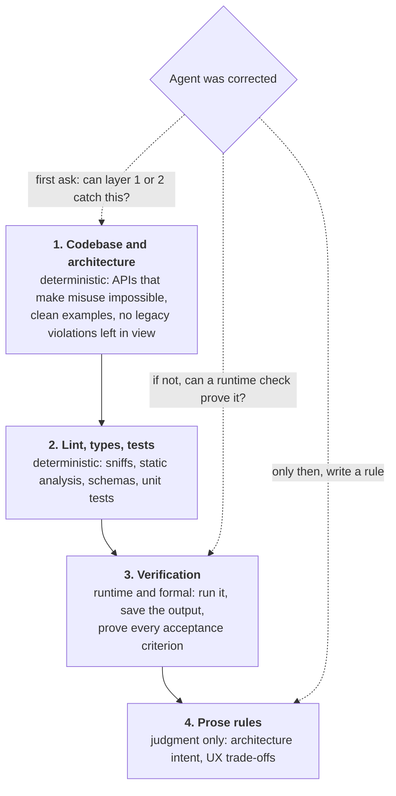
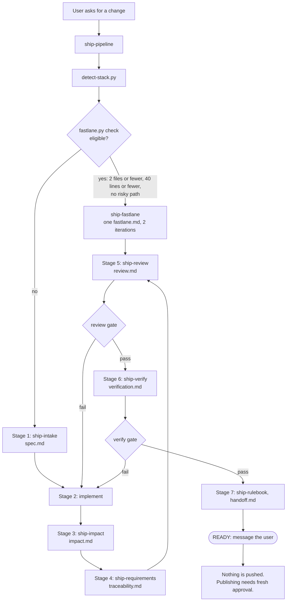
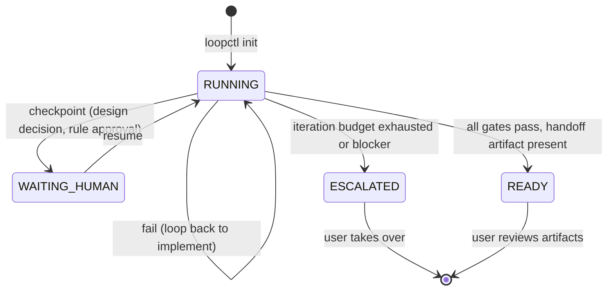
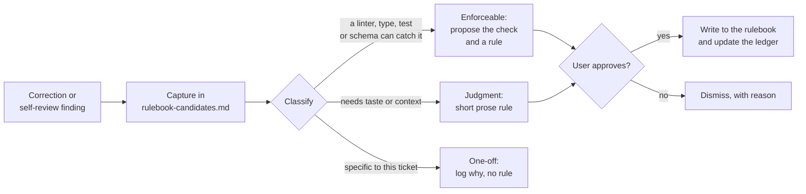
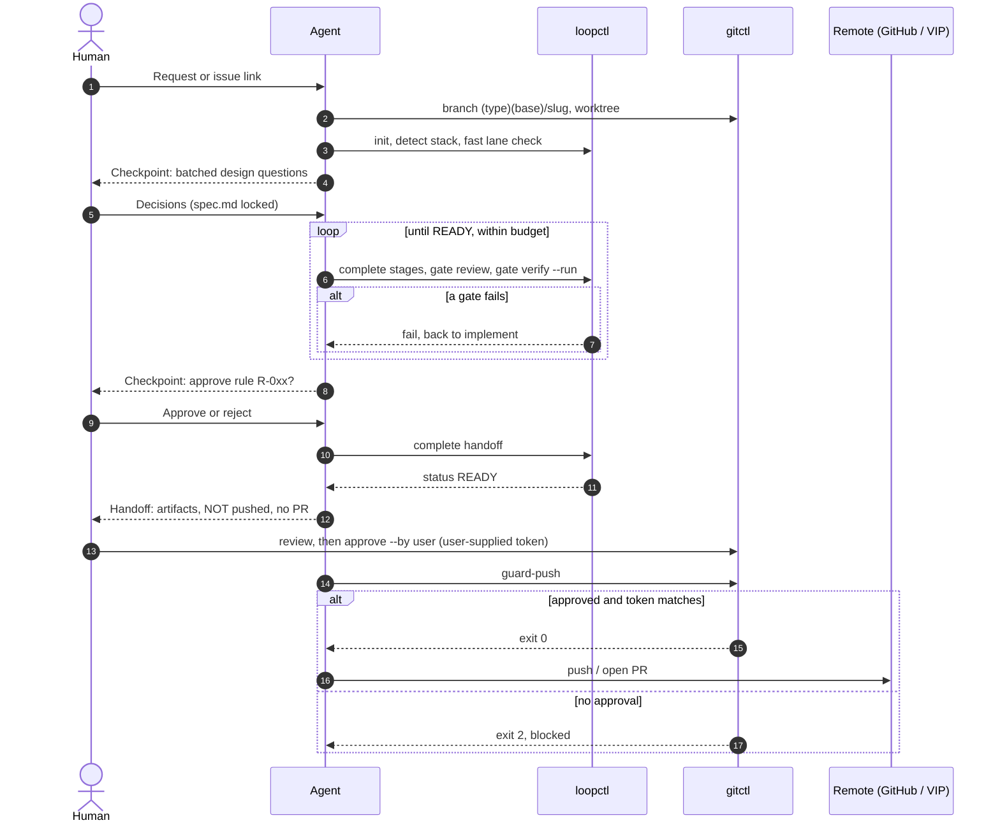

# Agent Skills & Delivery System

Version `0.2.0` — see [CHANGELOG.md](CHANGELOG.md).

A harness-neutral delivery system for coding agents (OpenCode, Claude Code,
Codex, Antigravity). It turns “I think this is done” into a replayable state
machine: every change passes the same stages, writes the same artifacts, and
can only reach **READY** once review and runtime evidence exist on disk. The
human reviews *evidence*, not a diff and a promise.

## Origin

This system was built from Lauren Tan's AI Engineer talk
**“All Code Is Slop (Except Mine)”**. The ideas taken from it, as recorded in
[AGENT_RULES.md](AGENT_RULES.md):

- Agents copy whatever the codebase makes look normal. The codebase is a garden;
  leave a weed in view and the next agent plants another.
- You cannot earn trust by prompting harder. A paragraph in a prompt cannot fail
  a build; a lint rule, type or test can.
- Comments and docs that justify a hack are not enforcement. They go stale.
- The effort that matters is **verification**: run it and keep the output.
- Prose rules are for real judgment calls, and should be the thinnest layer.

Those points became the trust pyramid and the single operating principle here:

> **Every agent correction becomes a deterministic check or an architectural
> fix — not another line in a prompt.**

## The trust pyramid

Rely on the layers in order. Anything a lower-numbered layer can catch should
never reach layer 4.



| Layer | In this repo |
|---|---|
| 1. Codebase / architecture | `ship-impact` finds consumers; `ship-review` rejects a workaround where a design fix belongs; R-003 cleans legacy violations when a guardrail lands |
| 2. Lint / types / tests | `ship-review` Pass A runs formatter, linter, static analysis and tests; `evals/` guard the skills themselves |
| 3. Verification | `ship-verify` and `loopctl gate --run`, which executes the check and writes the evidence itself |
| 4. Prose rules | [AGENT_RULES.md](AGENT_RULES.md), added only through `ship-rulebook` with user approval |

## What's here

```text
~/.agents/
├── AGENTS.md          Global agent instructions (pipeline and hard gates)
├── AGENT_RULES.md     Global rulebook R-001…R-014 and the rule ledger
├── CHANGELOG.md, VERSION
├── skills/
│   ├── ship-*/        12 delivery skills (tracked)
│   └── wp-*, blueprint, wordpress-router…   20 WordPress skills (local only)
├── scripts/           doctor, installer, link checker, stack detection
├── evals/             manifest.json (25 cases), fixtures/, last-report.md
├── .agent-work/       per-issue artifacts (git-ignored)
├── learning/          daily learning docs, telemetry, doctor report (local)
└── .github/workflows/validate.yml
```

- **Only `skills/ship-*` is tracked.** `.gitignore` is an allow-list; WordPress
  skills, `.agent-work/`, `learning/`, secrets and generated reports stay local.
- **`docs/` lives in each product repo.** A repo's own rules go in
  `<repo>/docs/agent-rules.md`, from `skills/ship-rulebook/assets/repo-rules-template.md`.
- **Skills are mirrored into three roots** (`~/.agents/skills`,
  `~/.config/opencode/skills`, `~/.claude/skills`). `scripts/install.py` copies
  them; `scripts/validate-skills.py` proves they are identical.
- **Instructions layer.** [AGENTS.md](AGENTS.md) and `~/.claude/CLAUDE.md` carry
  the pipeline rules; `~/AGENTS.md` adds the VIP map and CLI tool index.

## The ship pipeline

`ship-pipeline` is mandatory for any change to code, configuration or product
behaviour, in any stack, and runs as a closed loop under `ship-loop`:
**act → artifact → deterministic gate → advance or loop back.**

Four things must be proven, each with a file: what was asked (`spec.md` →
`traceability.md`), the blast radius (`impact.md`), that review passed
(`review.md`), and that it works at runtime (`verification.md` + `evidence/`).

### Stages

| # | Stage | Skill | Exit artifact |
|---|---|---|---|
| 0 | Prepare | `ship-git`, `ship-loop` | worktree, branch, loop initialised, stack detected |
| 1 | Intake | `ship-intake` | `spec.md`, design decisions locked |
| 2 | Implement | a domain skill | code change |
| 3 | Impact | `ship-impact` | `impact.md` |
| 4 | Requirements | `ship-requirements` | `traceability.md` |
| 5 | Review | `ship-review` | `review.md`, `review` gate |
| 6 | Verify | `ship-verify` | `verification.md`, `verify` gate |
| 7 | Handoff | `ship-rulebook` | `handoff.md`, status `READY` |

### Routing and flow



A failed gate sends work back to **implementation**, not to the artifact: fix
the code, then rerun impact → requirements → review → verify.

### Loop states

`loopctl.py` owns state in `.agent-work/<issue>/loop-state.json`, so any agent
can resume a loop; nothing depends on conversation memory.



`WAITING_HUMAN` and `ESCALATED` are the **only** early messages allowed. READY
means ready for *review*, never for publishing. **Budgets:** small fix 3, fast
lane 2, feature 6, cross-cutting 10 iterations; repeated failure at one gate
means escalate and add a rulebook candidate, never a silently larger budget.

### Artifacts — `.agent-work/<issue-id>/`

```text
loop-state.json        stage, iteration, gate results, history, timings
spec.md                problem, outcome, acceptance criteria AC-n, decisions
impact.md              changed symbols, verified consumers, risks, mitigations
traceability.md        AC-n → code file:line → check → runtime evidence
review.md              P0–P3 findings, mechanical checks, rulebook violations
verification.md        each check: expected, actual output, result
evidence/              raw command output cited by the files above
handoff.md             what the user reviews and decides
rulebook-candidates.md corrections awaiting approval
```

## Skills

### Pipeline skills

| Skill | Purpose |
|---|---|
| [`ship-pipeline`](skills/ship-pipeline/SKILL.md) | The orchestrator. Routes by stack and size, enforces stage order and hard gates, defines the handoff template. |
| [`ship-intake`](skills/ship-intake/SKILL.md) | Reads the issue including comments, lists every unmade decision, asks once in a batch, writes `spec.md`. Never implements with unresolved intent. |
| [`ship-impact`](skills/ship-impact/SKILL.md) | Maps the blast radius of each changed public symbol with verified consumers or a reproducible “none found”. |
| [`ship-requirements`](skills/ship-requirements/SKILL.md) | Mechanical comparison of what was asked to what was built; flags scope creep. Produces `traceability.md`. |
| [`ship-review`](skills/ship-review/SKILL.md) | Pass A runs formatter, linter, static analysis and tests; Pass B is a defect-first review ranked P0–P3. Read-only. |
| [`ship-verify`](skills/ship-verify/SKILL.md) | Proves each criterion at runtime with saved output. Backend, WP-CLI, browser, library and migration recipes. |

### Control and governance skills

| Skill | Purpose |
|---|---|
| [`ship-loop`](skills/ship-loop/SKILL.md) | The closed-loop controller. `loopctl` owns state, gates, budgets, telemetry; READY is the only handoff condition. |
| [`ship-git`](skills/ship-git/SKILL.md) | One branch, commit and PR-title standard, plus a push-approval guard. |
| [`ship-fastlane`](skills/ship-fastlane/SKILL.md) | A gated subset for small, low-risk changes: one compact artifact, two iterations, same no-push rule. |
| [`ship-rulebook`](skills/ship-rulebook/SKILL.md) | Classifies each correction as enforceable, judgment or one-off. Proposes exact text and writes only after approval. |
| [`ship-eval`](skills/ship-eval/SKILL.md) | Regression cases for the skills themselves; no skill change is READY with failing evals. |
| [`ship-teach`](skills/ship-teach/SKILL.md) | Turns the day's commits, artifacts and telemetry into a dated learning document with teach-back questions. |

### Stack adapters
Stage skills stay task-agnostic; stack commands live in adapters
(`ship-review/references/stacks.md`, `ship-verify/references/stacks.md`,
`ship-impact/references/languages.md`). `detect-stack.py` picks the adapter from
`composer.json`, `package.json`, `go.mod`, `Cargo.toml`, `pyproject.toml`,
`requirements.txt` or `setup.py`.

### Git standard
| Item | Form | Example |
|---|---|---|
| Branch | `<type>(<base>)/<kebab-slug>` | `feat(master)/add-vehicle-cpt` |
| Commit | `<type>: <lowercase imperative>` | `feat: add public vehicle CPT` |
| PR title | `<type>(<base>): <name>` | `feat(master): add public vehicle CPT` |

Types are `feat fix perf chore docs refactor test build ci style revert`;
subjects are 72 characters or fewer. Git refs cannot contain `:`, so branches
use `/` and the colon is reserved for PR titles. Stacked PR bases are rejected.

The twenty WordPress skills beside the `ship-*` set are *domain* skills used in
stage 2 and by `ship-verify`; they are local and not part of the tracked system.

## Scripts and utilities

### Repo tooling — [`scripts/`](scripts/)

| Script | What it does |
|---|---|
| [`doctor.py`](scripts/doctor.py) | One command for the full health check; writes `learning/doctor-latest.md`. |
| [`check-docs.py`](scripts/check-docs.py) | Verifies local Markdown links in tracked `.md` files resolve; ignores remote URLs and anchors. |
| [`install.py`](scripts/install.py) | Installs or verifies `ship-*` skills and shared assets in every harness root; leaves third-party skills alone. |
| [`validate-skills.py`](scripts/validate-skills.py) | Proves `ship-*` skills and shared scripts are byte-identical across roots. |
| [`detect-stack.py`](scripts/detect-stack.py) | Detects the project stack from manifests and suggests an adapter. |

### Skill controllers — `skills/*/scripts/`

| Script | Subcommands | Used by |
|---|---|---|
| `loopctl.py` | `init`, `status`, `complete`, `gate`, `fail`, `checkpoint`, `resume`, `handoff`, `telemetry` | `ship-loop`, every stage |
| `gitctl.py` | `branch`, `commit-msg`, `pr-title`, `approve`, `guard-push`, `install-hooks` | `ship-git` |
| `fastlane.py` | `check`, `scaffold` | `ship-fastlane`, pipeline stage 0 |
| `evalctl.py` | `run`, `doctor` | `ship-eval`, CI |
| `teach-digest.py` | digest of commits, artifacts and telemetry | `ship-teach` |

### How gates are enforced

`loopctl` never takes the agent's word for it:

- A stage completes only if its artifact exists and is non-empty.
- `gate --passed` needs an evidence file with a pass marker and no failure
  markers; empty or marker-less evidence is rejected.
- `gate --run "<cmd>"` executes the command itself (no shell), saves the output
  as evidence, and fails the gate on a non-zero exit.
- `--compact` (fast lane) requires a `## <stage>` heading per stage.
- `handoff` prints nothing unless the status is `READY`.

## Hard rules

The non-negotiables, mostly enforced by code rather than by asking nicely:

1. **Never push, open a PR, merge or deploy without explicit user approval.**
   Broad local access is not publishing consent; each action needs fresh
   approval, and `ship-git guard-push` must pass first.
2. **Approval is human-only.** `gitctl approve` requires `--by user` and a token
   the user supplies (`SHIP_APPROVAL_TOKEN` or a `chmod 600` token file). It
   records a fingerprint and expiry; `guard-push` refuses if the token changes
   or disappears. An agent cannot approve its own push.
3. **Never mark work complete without `review.md` and `verification.md`** with
   passing critical checks and saved output.
4. **Every correction becomes a deterministic check or an architectural fix.**
   Only judgment calls become prose rules.
5. **Finish the loop before messaging**, except checkpoints and escalations.
6. **One Git standard**, validated by `ship-git`, in every repository.
7. **Never write a rulebook entry without approval.** Show the exact diff first.
8. **Keep skills task-agnostic.** Stack commands live in `references/stacks.md`.
9. **Run `ship-eval` after any skill, script or rulebook edit.** Failing evals
   mean the change is not READY.
10. **Repeated work becomes a script** (R-011). The fast lane skips ceremony,
    never proof.

## Getting started

### 1. Install the skills

```bash
cd ~/.agents
python3 -I scripts/install.py            # copy ship-* into every harness root
python3 -I scripts/validate-skills.py    # prove the roots are identical
```

Third-party skills in the harness roots are not touched.

### 2. Let the harness read the rules

Harnesses load `AGENTS.md` (and `~/.claude/CLAUDE.md`), which require
`ship-pipeline` for any code-changing task, so a one-line request starts it.

### 3. Optional: install the git hooks

Run `gitctl.py install-hooks --repo /path/to/repo` to add a `commit-msg` hook
(conventional subjects) and a `pre-push` hook that runs `guard-push`. Ask before
installing in a repo you do not own.

### 4. Ask for a change

```text
You:    Fix issue #206 — the vehicle archive shows drafts.
Agent:  Checkpoint: public archive only, or logged-in editors too?
You:    Public only.
Agent:  … works silently through impact, review, verify …
Agent:  Handoff — #206 ready for your review. NOT pushed, no PR opened.
```

### 5. Review artifacts, then decide

Open `.agent-work/<issue>/handoff.md`; it links the spec, impact, traceability,
review (P0–P3 counts), verification (`n/n` passed) and evidence. Ask for
changes, or explicitly approve publishing.

To drive a loop by hand, follow the command sequence in
[`ship-loop`](skills/ship-loop/SKILL.md). On failure run
`loopctl fail <issue> --reason "P1: unescaped output in view.php:42"`, fix the
code and rerun downstream stages; for a missing decision use `loopctl checkpoint`
then `loopctl resume`.

### 6. The fast lane

For a typo, a one-line config, a single test or a formatting fix:

```bash
python3 skills/ship-fastlane/scripts/fastlane.py check --files a.py b.py
```

Eligible means **all** of: two files or fewer, 40 changed lines or fewer, no
migration, schema, auth, security, secret, billing, deploy or infrastructure
path, no change to public API, data shape or behaviour, and no open design
question. The check is deterministic; if the change grows it moves to the full
pipeline.

## Rulebook and learning

### The rulebook
Two layers, both written only with user approval: global
([AGENT_RULES.md](AGENT_RULES.md)) and per repo (`<repo>/docs/agent-rules.md`).
`ship-rulebook` runs at handoff and whenever you say “add a rule” or “note this
for next time”:



Prefer enforceable; comments and docs never fix a repeated mistake. Self-review
findings are shown with evidence, and the agent never silently promotes its own
opinion to a rule. Rules `R-001`…`R-014` and the decider ledger are in
[AGENT_RULES.md](AGENT_RULES.md).

### Learning documents

At the end of a workday, `ship-teach` converts the day's commits,
`.agent-work` artifacts and loop telemetry into study material:

```bash
python3 skills/ship-teach/scripts/teach-digest.py \
  --since 2026-11-21 --repo /path/to/repo-a --repo /path/to/repo-b \
  --out learning/2026-11-21-digest.md
```

The skill then writes `learning/YYYY-MM-DD.md`: a *today at a glance* table,
three or four lessons, the guardrail that now prevents each mistake, decisions
future agents must remember, and teach-back questions. It is read-only toward
product code, never pushes, and never invents a lesson the artifacts do not
support. `learning/` also holds `telemetry-<date>.md` and `doctor-latest.md`
(local, git-ignored).

## Evaluation and health checks

Skills are code, so they have tests. [`evals/manifest.json`](evals/manifest.json)
holds **25 regression cases**, and the latest run passes **25/25**. They cover
`ship-git` (accept and reject branch, commit and PR-title forms; push guard;
self-approval rejected; user token accepted), `ship-loop` (gates need evidence,
`--run` captures it, compact mode needs a stage section, telemetry and timing),
`ship-fastlane` (eligible passes; risky paths and size overruns rejected),
`ship-teach`, the installer (dry run, cross-root sync) and stack detection.

A case has `command`, optional `cwd`/`env`, `expect_exit`, and regexes for
`expect_out` / `forbid_out`. Never edit an expectation just to turn a case
green — only when the user deliberately changed the standard, and say so.

```bash
python3 -I skills/ship-eval/scripts/evalctl.py run                  # writes evals/last-report.md
python3 -I skills/ship-eval/scripts/evalctl.py run --skill ship-git
```

### `doctor.py` — one command, every check

Run both from `~/.agents/` (doctor uses the working directory):

```bash
python3 -I scripts/check-docs.py --root .      # local Markdown links
python3 -I scripts/doctor.py                   # every check below
```

| Check | Fails when |
|---|---|
| cross-root sync | a `ship-*` skill or shared script differs between roots |
| skill evals | any manifest case fails |
| doc links | a local Markdown link does not resolve |
| branch standard | a skill still shows the retired `feat(master)-` branch form |
| neutral skill paths | a skill hardcodes a harness-specific path |
| telemetry | the loop telemetry report cannot be generated |

It writes `learning/doctor-latest.md` and prints `ALL CHECKS PASSED` or a
`FAILED:` list. Running evals refreshes timestamps in the `gate-run` fixture's
`loop-state.json`; review that diff before staging.

CI ([`validate.yml`](.github/workflows/validate.yml)) runs on every pull request
and on pushes to `main`: install, `doctor.py`, evals, then `git diff
--exit-code` to prove the checkout is unchanged.

## WordPress and VIP context

WordPress is the primary stack, but no delivery stage is WordPress-specific;
WordPress behaviour arrives through adapters and domain skills:

- **Detection:** `composer.json` maps to `php` in `detect-stack.py`.
- **Static checks:** the `ship-review` adapter, `wp-phpstan`, PHPCS and `php-cs-fixer`.
- **Runtime proof:** the `ship-verify` adapter runs `php -l`, then WP-CLI smoke
  checks on local, `wp-env` or Playground, and cleans up smoke content.
- **Build work:** `wp-plugin-development`, `wp-block-development`,
  `wp-block-themes`, `wp-rest-api`, `wp-performance`, `wp-project-triage`.

### WordPress VIP

For WordPress VIP repositories, address environments with VIP CLI targets of the
form `@<app>.<env>` — `develop`, `preprod` and `production`, or `develop` and
`production` where there is no preprod — instead of asking which environment is
meant. The app-slug to repository table lives in `~/AGENTS.md`.

`ship-verify` treats platform diagnostics as **read-only**:

```bash
vip @<app>.develop logs | rg -C 3 "Fatal error|Exception" | tail -n 25
vip @<app>.production slowlogs | head -n 30
vip @<app>.develop wp plugin list --format=json
```

No deploys, cache purges, remote writes or destructive commands from a
verification step; those are publishing actions and need fresh approval.

## Where the human sits

The agent works silently inside the loop. The human appears at a **checkpoint**
(a decision), a **rule approval**, the **handoff**, and a separate, explicit
**publish** approval.



If the budget runs out the loop goes to `ESCALATED` and the agent messages with
the artifacts so far and the blocker. Changing the system itself follows the
same rules: add an eval case, run `install.py` then `doctor.py`, update
[CHANGELOG.md](CHANGELOG.md), and stop before publishing.
